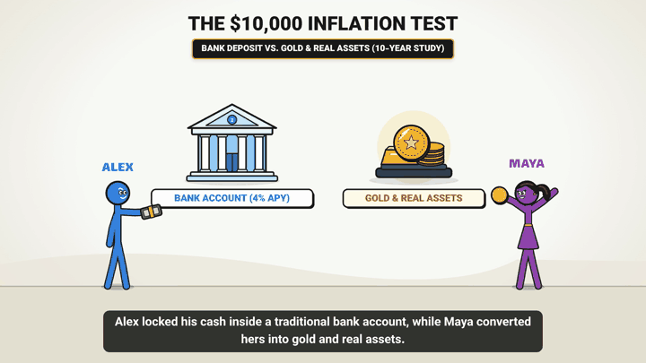
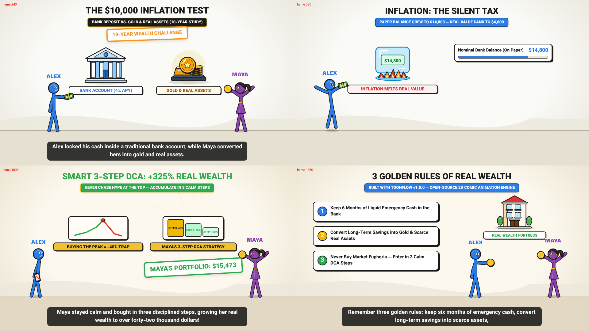
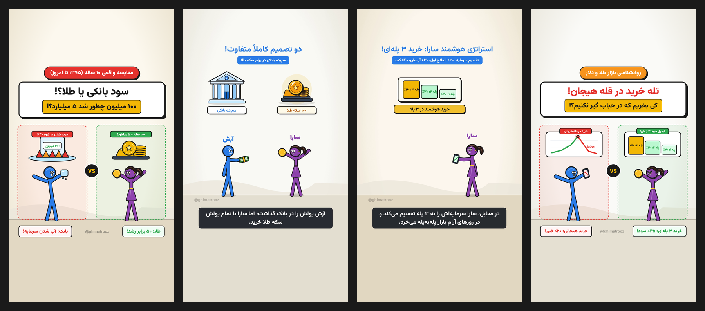
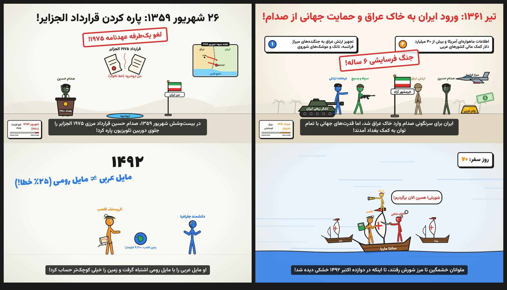

<div align="center">


# ToonFlow

**A studio-grade 2D comic & stick-figure animation engine for 16:9 explainers, documentaries, and 9:16 viral Reels.**

Two-Pass Seamless Characters · Complete Male & Female Rigs · 16:9 & 9:16 Safe-Zone Stage · Auto-Bidirectional LTR & RTL Typography · 25+ Vector Props · Procedural Audio & Frame-Accurate Voice Sync

[](https://github.com/ZALPRO/toonflow/releases)
[](LICENSE)
[](https://www.remotion.dev)
[](references/engine-api.md)
[](examples/)
[%20%2B%20RTL%20(FA%2FAR)-f7941d?style=flat-square)](README.fa.md)

[Live Demo & Showcase](#live-demo--showcase) · [What It Is](#what-it-is) · [Quick Start](#quick-start) · [Key Features](#key-features) · [Shipped Productions](#shipped-production-examples) · [Architecture](#repository-architecture) · [🇮🇷 راهنمای کامل فارسی](README.fa.md)

<br>

<a href="https://github.com/ZALPRO/toonflow/releases/download/v1.0.0/toonflow-showcase-en.mp4">
  
</a>

<p align="center">
  <a href="https://github.com/ZALPRO/toonflow/releases/download/v1.0.0/toonflow-showcase-en.mp4"><b>▶ Watch / Download Full 1080p English Demo Video with Studio Voiceover, SFX &amp; Music (<code>toonflow-showcase-en.mp4</code> · 53s)</b></a>
  &nbsp;·&nbsp;
  <a href="https://github.com/ZALPRO/toonflow/releases/tag/v1.0.0"><b>📦 View All v1.0.0 Release Videos &amp; Archives</b></a>
</p>

</div>

---

## What It Is

**ToonFlow (`v1.0.0`)** is a deterministic, code-driven 2D comic animation engine and AI Agent / [Claude Code](https://claude.com/claude-code) skill built on Remotion 4. It transforms any topic, script, `.srt` subtitle file, studio voiceover, or YouTube transcript into broadcast-ready animated videos in both **16:9 Horizontal (`1920×1080`)** and **9:16 Vertical (`1080×1920`)** formats.

Unlike generic single-stroke stick-figure templates, ToonFlow renders every character in **two continuous passes** (`16px` `#1a1a1a` ink outline + `11px` vibrant character fill across head, torso, arms, and legs) with zero internal joint seams, velocity-blended walk/run kinematics, expressive cartoon eyes with automatic blinking, and a complete **male & female character system**.

| Area | What You Get in `ToonFlow v1.0.0` |
|---|---|
| **Character Engine (`stick.tsx`)** | Seamless two-pass comic outline (`PASS 1` black ink + `PASS 2` inner color fill), grounded contact shadows that scale with jump height, velocity-blended walk/run cycles, forward-positive mirrored kinematics (`facing = 1 \| -1`), motion-blur ghost trails, and 6 facial expressions (`happy`, `sad`, `angry`, `shock`, `smirk`, `meh`) |
| **Male & Female Rigs** | **Complete Female Character System (`hat="ponytail"`)**: sculpted front hair crown, parted bangs, temple side-lock, gold stud earring, S-curve flowing ponytail with golden scrunchie, cartoon eyelashes, pupil catchlights, rosy cheek blush, and seamless two-pass A-line comic dress with golden belt. Plus 15+ historical, military & role hats (`crown`, `admiral`, `helmet_ir`, `beret`, `scholar`, `pilot`, etc.) |
| **Hand-Held Props (`handProp`)** | Built-in hand props attached directly to the front hand joint (`"cash"`, `"coin"`, `"ice"`, `"phone_red"`, `"phone_green"`) with wide V-shape arm poses (`P.cheer`, `P.shock`) so props never overlap the face |
| **Dual Aspect-Ratio Stage** | **16:9 YouTube & Documentary (`1920×1080`, `GROUND_Y = 852`)** and **2026 Instagram Reels / TikTok / Shorts Safe-Zone (`1080×1920`, `V_GROUND_Y = 1220`, `Captions` at `bottom = 480`)** keeping top `14%`, bottom `35%`, left `6%`, and right `120px` UI rails completely clear |
| **International Typography** | Auto-bidirectional script detection (`isRTL()` / `dirOf()`) across `<Slam>`, `<Caption>`, `<Card>`, `<Stamp>`, `<StatBar>`, `<WordBlock>`, `<Captions>`, and character labels — supporting English, European languages, Persian (`fa-IR`), and Arabic out of the box |
| **25+ Vector Props (`props.tsx`)** | Unified library of comic SVG illustrations: `SavingsBundleIcon`, `Bank`, `SafeBox`, `HouseProp`, `InflationMeltIcon`, `FomoTrapChartIcon`, `BreakingHypeIcon`, `BubbleMeterIcon`, `StepLadderIcon`, `Ship`, `ScrollMap`, `Spyglass`, `Tank`, `FighterJet`, `MosqueDome`, `RadarTower`, `Bunker`, `PeaceDove`, and more |
| **Studio Audio & Sync** | Procedural synthesizer (`scripts/gen_audio.py`) generating 34 WAV sound effects and chapter-aware background music with automatic voice ducking, plus `scripts/sync_elevenlabs.py` for pure time-domain silence trimming and frame-accurate cue alignment |

---

## Live Demo & Showcase

### 1. Flagship 16:9 English Financial Explainer (`examples/00-english-wealth-explainer-16x9/`)
*Topic: **"The $10,000 Inflation Test: Bank Savings vs. Gold & Real Assets"** (`1920×1080`, `30fps`, `1589 frames`, `52.97s`) — Full source in [`examples/00-english-wealth-explainer-16x9/`](examples/00-english-wealth-explainer-16x9/) and rendered MP4 in [`docs/media/toonflow-showcase-en.mp4`](docs/media/toonflow-showcase-en.mp4).*

<p align="center">
  
</p>

### 2. Viral 9:16 Vertical Reels & Safe-Zone Covers (`examples/01..02`)
*Engineered for the **2026 Instagram Reels / TikTok / Shorts Safe Zone (`1080×1920`, `V_GROUND_Y = 1220`)** with dedicated `9:16`, `4:5`, and `3:4` grid-safe thumbnail covers (`Covers.tsx`).*

<p align="center">
  
</p>

### 3. 16:9 Historical & Geopolitical Documentaries (`examples/03..04`)
*Multi-actor historical and documentary productions featuring custom `<Paper>` atmosphere themes (`airraid`, `liberation`, `gulf`, `peace`), `<TimelineHUD>`, animated `<StatBar>` charts, naval caravels, and military hardware.*

<p align="center">
  
</p>

---

## Quick Start

### 1. Install as an AI Agent / Claude Code Skill

```bash
git clone https://github.com/ZALPRO/toonflow.git ~/.claude/skills/toonflow
pip install -r ~/.claude/skills/toonflow/requirements.txt
```

### 2. Scaffold a Standalone Animation Studio Project

```bash
# 1. Create a new Remotion project with the ToonFlow v1.0.0 engine installed in src/stickman/
python3 scripts/setup_project.py --dir ./my-toonflow-studio --create

# 2. Create a 16:9 YouTube composition (1920x1080) or a 9:16 Reels composition (1080x1920)
python3 scripts/new_video.py --project ./my-toonflow-studio --slug wealth-explainer --size 1920x1080
python3 scripts/new_video.py --project ./my-toonflow-studio --slug viral-reel --size 1080x1920

# 3. Synthesize procedural SFX & chapter-aware background music
python3 scripts/gen_audio.py --out ./my-toonflow-studio/public/wealth-explainer --plan "intro:12,tense:14,hope:13,finale:15"

# 4. Run visual QA contact sheets & render 1080p MP4
cd ./my-toonflow-studio
npx tsc --noEmit
node stickman-sheet.mjs WealthExplainer out/sheet.png 0-1200:300
npx remotion render src/index.ts WealthExplainer out/wealth-explainer.mp4 --codec=h264 --audio-codec=aac --audio-bitrate=192k
```

---

## Key Features

### 🎭 Two-Pass Seamless Male & Female Character Engine (`assets/engine/stick.tsx`)
```tsx
import { Actor, GROUND_Y, P, SMOOTH, SNAP, groundY } from "../stickman/stick";
import { COL } from "../stickman/fx";

const SCALE = 1.42;
const GY = groundY(SCALE, GROUND_Y);

// Male Character (Alex) holding a cash bundle
<Actor
  f={f}
  keys={[
    { f: 0, p: { x: -120, y: GY, ...P.stand } },
    { f: 28, p: { x: 350, y: GY, ...P.pointR }, e: SMOOTH, dur: 26 },
  ]}
  color={COL.blue}
  scale={SCALE}
  facing={1}
  face="happy"
  label="ALEX"
  handProp="cash"
/>

// Complete Female Character (Maya) with sculpted hair crown, bangs, ponytail, earring & A-line dress
<Actor
  f={f}
  keys={[
    { f: 0, p: { x: 2040, y: GY, ...P.stand } },
    { f: 30, p: { x: 1570, y: GY, ...P.cheer }, e: SMOOTH, dur: 26 },
  ]}
  color={COL.purple}
  scale={SCALE}
  facing={-1}
  hat="ponytail"
  face="happy"
  label="MAYA"
  handProp="coin"
/>
```

### ⚡ Physical Typography, 2-Tier Headers & Verdict Stamps (`assets/engine/fx.tsx`, `common.tsx`)
- **`<Slam>` & 2-Tier Headers**: High-impact title slam (`scale: 3.2 → 1.0` with motion blur) paired with a colored pill sub-banner.
- **`<Card>`**: Bounce-animated numbered takeaway cards that automatically align badges on the left for English (`LTR`) and on the right for Persian/Arabic (`RTL`).
- **`<Stamp>`**: Angled rubber-stamp verdict badges with impact scale bounce.
- **`<StatBar>`**: Animated horizontal data comparison bars with smooth easing.

---

## Shipped Production Examples

All **5 full production projects** in [`examples/`](examples/) compile with zero TypeScript errors (`npx tsc --noEmit`) and include every scene, cue, SFX map, and frame-locked timeline:

| # | Directory | Format | Duration | Rendered MP4 | Description |
|---|---|---|---|---|---|
| **00** | [`examples/00-english-wealth-explainer-16x9/`](examples/00-english-wealth-explainer-16x9/) | `1920×1080` (`16:9`) | `52.97s` (`1589f`) | [▶ Watch MP4](https://github.com/ZALPRO/toonflow/releases/download/v1.0.0/toonflow-showcase-en.mp4) | **English Flagship Demo**: *The $10,000 Inflation Test: Bank Savings vs. Gold & Real Assets* (`Alex` & `Maya`) |
| **01** | [`examples/01-bank-vs-gold-reel-9x16/`](examples/01-bank-vs-gold-reel-9x16/) | `1080×1920` (`9:16`) | `52.53s` (`1576f`) | [▶ Watch MP4](https://github.com/ZALPRO/toonflow/releases/download/v1.0.0/ghimatrooz-reel-9x16.mp4) | **Vertical Financial Reel**: *Bank Deposit vs. Gold & Real Estate in Inflation* (`آرش` & `سارا`) |
| **02** | [`examples/02-fomo-market-trap-reel-9x16/`](examples/02-fomo-market-trap-reel-9x16/) | `1080×1920` (`9:16`) | `69.27s` (`2078f`) | [▶ Watch MP4](https://github.com/ZALPRO/toonflow/releases/download/v1.0.0/ghimatrooz-fomo-reel-9x16.mp4) | **Vertical Market Psychology Reel + `Covers.tsx`**: *The FOMO Peak Trap vs. 3-Step Smart DCA* |
| **03** | [`examples/03-iran-iraq-war-documentary-16x9/`](examples/03-iran-iraq-war-documentary-16x9/) | `1920×1080` (`16:9`) | `86.13s` (`2584f`) | [▶ Watch MP4](https://github.com/ZALPRO/toonflow/releases/download/v1.0.0/iran-iraq-war-16x9.mp4) | **Historical Documentary**: *8-Year Iran-Iraq War (1980–1988)* with military props, themes & `<StatBar>` |
| **04** | [`examples/04-christopher-columbus-16x9/`](examples/04-christopher-columbus-16x9/) | `1920×1080` (`16:9`) | `82.98s` (`2489f`) | [▶ Watch MP4](https://github.com/ZALPRO/toonflow/releases/download/v1.0.0/christopher-columbus-16x9.mp4) | **Biographical Explainer**: *The 1492 Voyage of Christopher Columbus* with naval caravels & royal court |

---

## Repository Architecture

```text
toonflow/
├── SKILL.md                                    # AI Agent & Claude Code production workflow
├── README.md                                   # Complete English documentation & visual showcase
├── README.fa.md                                # Complete Persian documentation (راهنمای کامل فارسی)
├── LICENSE                                     # MIT License (ToonFlow Studio)
├── requirements.txt                            # Python dependencies (numpy, scipy, pillow)
├── docs/
│   ├── logo.svg                                # Official ToonFlow vector emblem
│   └── media/
│       ├── toonflow-showcase.gif               # Auto-playing animated showcase GIF (< 2 MB)
│       ├── toonflow-showcase-en.mp4            # Full 1080p English Demo Video with Studio Audio (53s)
│       ├── showcase-16x9-en.png                # 4-panel English 16:9 Explainer storyboard
│       ├── showcase-9x16-reels.png             # 4-panel Vertical 9:16 Reels & Covers showcase
│       └── showcase-16x9-documentary.png       # 4-panel 16:9 Historical & Documentary showcase
├── references/
│   ├── engine-api.md                           # Full API reference for stick, fx, common & props
│   ├── animation-style.md                      # 9:16 & 16:9 scene recipes, pacing & visual metaphors
│   ├── voice-design-and-reels-guide.md         # Studio Voice Design prompt + 2026 Reels Safe-Zone spec
│   └── pitfalls.md                             # Kinematics, Safe-Zone & headless Chromium QA checklist
├── examples/
│   ├── README.md                               # Guide to all 5 shipped production projects
│   ├── 00-english-wealth-explainer-16x9/       # Flagship 16:9 English Financial Explainer
│   ├── 01-bank-vs-gold-reel-9x16/              # 9:16 Bank vs. Gold Inflation Reel
│   ├── 02-fomo-market-trap-reel-9x16/          # 9:16 FOMO Trap vs. 3-Step DCA Reel + Covers.tsx
│   ├── 03-iran-iraq-war-documentary-16x9/      # 16:9 Historical War Documentary
│   └── 04-christopher-columbus-16x9/           # 16:9 Biographical Voyage Explainer
├── assets/
│   ├── engine/
│   │   ├── stick.tsx                           # Two-Pass Comic Character Engine (Male & Female)
│   │   ├── fx.tsx                              # Paper themes, Slam/Drop titles, Burst, Dust, Wipe
│   │   ├── common.tsx                          # Stage, Card, Stamp, StatBar, Captions, ReelBadge
│   │   ├── props.tsx                           # Unified 25+ Finance, History & Documentary SVG Props
│   │   └── fomo-props.tsx                      # Standalone FOMO & DCA Staircase Props module
│   ├── template/                               # Starter scene, video, SFX & 9:16 Cover templates
│   └── stickman-sheet.mjs                      # Auto-aspect (9:16 / 16:9) visual QA contact sheet tool
└── scripts/
    ├── setup_project.py                        # Scaffold Remotion project & install ToonFlow engine
    ├── new_video.py                            # Create & register 16:9 or 9:16 composition
    ├── parse_input.py                          # Script / SRT -> frame-accurate timeline.ts
    ├── gen_audio.py                            # Procedural 34-SFX & background music synthesizer
    ├── sync_elevenlabs.py                      # Studio voice silence trimmer & frame-accurate sync
    ├── align_voice.py                          # Word-level voiceover alignment
    └── check_render.py                         # Automated render & audio dBFS verification
```

---

## License

Released under the [MIT License](LICENSE) — **ToonFlow Studio (`v1.0.0`)**.
